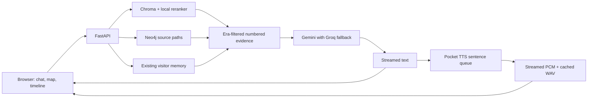

# Jensen Huang Digital Twin

[Live office](https://rj8307-digital-twin-2.hf.space) · [Project showcase](https://rj8307-digital-twin-2.hf.space/showcase) · [Space source](https://huggingface.co/spaces/RJ8307/digital-twin-2/tree/main)

Chat grounded in the included Jensen source collection, with Chroma retrieval and reranking, Neo4j source paths, conversational memory, streamed text, and Pocket TTS using the original Jensen reference recording.

## Explore the project

- Text arrives incrementally. Three bouncing dots remain visible during generation, and Stop reply cancels an unfinished answer without recording it as a completed server turn.
- Speech begins sentence by sentence while text is arriving. PCM audio streams from Pocket TTS; the bounded voice queue shows its state. Stop Voice cancels the active synthesis, clears queued sentences, and stops buffered sound.
- Ambient music starts on Enter Office, with a toggle and volume slider, and softens during speech.
- Numbered citations open exact source excerpts. Original links come from the source registry. Video timestamps are included only when the corpus provides them; chunk numbers never become invented timestamps.
- Jensen’s World is available before chatting. Topic clicks ask a real question in the current session. Inspect co-mentions or extracted relationships, their direction, and supporting quotes.
- The source timeline shows dated coverage. Compare two years and a topic using only passages from those years; unknown or missing coverage is reported.
- Conversation, beginner, startup pitch, and architecture review modes provide different response structures. Comparisons have a dedicated timeline workflow.
- Inspect and correct individual remembered facts, forget them, and see which facts were included in each answer. Forgotten wording is suppressed from later extraction of old chat. Paraphrases are not semantic deletion guarantees.
- The showcase includes three guided demos, an architecture diagram, corpus quality checks, a corpus fingerprint, and published evaluation results.

## Source graph and GraphRAG

Startup reads all existing Chroma passages without re-embedding. A topic/alias catalog identifies entities that are actually present; it builds a full co-mention map. A separate bounded model job extracts `INTRODUCED`, `BUILT_ON`, `ENABLES`, `USES`, `DISCUSSED_AT`, and `PARTNERED_WITH` relationships. Each accepted link must use existing entity IDs, an allowed predicate with compatible entity types, and an exact contiguous quote mentioning both entities and explicit relationship wording in the same clause. Active/passive direction is checked. Those checks establish provenance, not independent human verification of the interpretation. Co-mentions never imply causation or partnership.

`MAP_RELATION_BATCHES` defaults to 8, with six passages per batch. Round-robin sampling covers different source files. The complete topic map uses the full corpus; semantic extraction initially samples up to 48 passages. Increase the batch limit (maximum 60) and restart with a new corpus version for broader extraction. Results are cached by corpus fingerprint in Neo4j to avoid repeat provider calls on restart.

Normal chat uses up to two hops in Neo4j’s public source graph to retrieve related excerpts alongside Chroma results. If Neo4j is unavailable, the same bounded traversal runs over the corpus graph. Every path’s evidence is filtered by era, and year comparisons remove other years. Response metadata includes paths, the retrieval backend, citations, and timing.

Public source data uses `DTKnowledgeMap`, `DTKnowledgeEntity`, and `DT_KNOWLEDGE_LINK`. Visitor facts use the existing separate `MemoryEntity`, `MemoryBatch`, and `MEMORY_LINK` namespace. Source fingerprint changes retire obsolete public entries and retain the prior map payload; they never delete visitor memory.

## Corpus versions and quality

`ingest.py` hashes file content, upserts a changed source under versioned chunk IDs, and removes obsolete chunks only after the new write succeeds. Unchanged sources are skipped. Run the optional data pipeline manually, then restart the Space to build the new map.

Quality checks flag exact duplicate passages, undated material, missing original URLs, and likely transcription problems. They preserve original quotes for review. The shipped `jensen_personal.txt` is tagged 2007 but contains 2025/2026 events: its publication date is treated as unverified and it is excluded from era-limited answers. The original `milken_2026.txt` links to the [Milken Institute’s 2025 Global Conference transcript](https://milkeninstitute.org/sites/default/files/2025-05/new-innovation-economy-conversation-nvidia-ceo-jensen-huang_Transcript_GC25.pdf); its effective year is corrected to 2025 while retaining the original declared year. See the [official conference description](https://milkeninstitute.org/content-hub/newsletters/fintech-focus/fintech-focus-may-27-2025).

## Configuration

Keep keys in **Hugging Face Settings → Secrets**, never Git:

| Secret | Purpose |
| --- | --- |
| `GOOGLE_API_KEY_1`, `GOOGLE_API_KEY`, or `GEMINI_API_KEY` | Gemini generation; numbered keys 1–3 supported |
| `GROQ_API_KEY` | Groq fallback; Groq-only deployment supported |
| `HF_TOKEN` | Read token from an account approved for `kyutai/pocket-tts` cloning weights |
| `NEO4J_URI` | Aura URI such as `neo4j+s://your-instance.databases.neo4j.io` |
| `NEO4J_USERNAME` | Your database username |
| `NEO4J_PASSWORD` | Your database password |

Leave `NEO4J_DATABASE` unset to use the database user’s home database. `MEMORY_UPDATE_TURNS=5` counts completed user/assistant pairs. `.env.example` lists optional variables. The original `jensen_ref.wav` is encoded once per successful model initialization; inaccessible weights produce a useful error and a retry cooldown.

Gemini transient failures get bounded retries, then Groq fallback. Streaming never switches providers after partial text has been emitted. Interrupted or truncated replies are not persisted as completed turns. Pocket’s CPU model is serialized because concurrent generation on one model is not supported.

## Existing memory and storage design

Visitor IDs and browser sessions retain the existing implementation. Server chat turns and pending extraction remain in the existing local SQLite database; this update does not migrate them to durable storage. Neo4j facts remain in the external database. The default Space filesystem remains ephemeral across rebuilds.

Memory extraction runs after five completed turns, with manual flush available. Failed extraction retains pending turns for retry. Fact edits and deletions are scoped to the current visitor. Browser chat deletion only removes its local display; saved memory is managed separately. This remains an anonymous demo with the existing visitor-ID access scheme.

## Architecture



## Local development and evaluation

```sh
python3.12 -m venv .venv
source .venv/bin/activate
pip install torch --index-url https://download.pytorch.org/whl/cpu
pip install -r requirements.txt
cp .env.example .env.local
# Add your own credentials to the ignored .env.local file.
git lfs pull
uvicorn main:app --host 0.0.0.0 --port 7860
```

Install libsndfile locally; Docker installs it and ffmpeg. `git lfs pull` retrieves the actual corpus, images, and reference WAV. For data collection/cleaning, install `requirements-ingest.txt` separately.

```sh
pip install pytest httpx
python -m pytest -q tests
node --check static/app.js
node --check static/stream.js
node --check static/explorer.js
node --check static/workbench.js
python benchmark.py --base http://127.0.0.1:7860
```

The benchmark uses 50 fixed retrieval questions and eight generated replies. It reports expected-topic matches, era-filter checks, citation resolution, completion, and observed streaming latency. Topic hits and valid citation IDs are not overall answer accuracy. The report records its corpus fingerprint and limitations; `/showcase` displays the published `reports/benchmark.json`. Evaluation uses only its own disposable visitor IDs and cleans them up afterward.

## API

| Route | Purpose |
| --- | --- |
| `GET /api/health` | Configuration and voice readiness without secret values |
| `POST /api/chat` | Complete reply with citations, graph paths, and timing |
| `POST /api/chat/stream` | NDJSON `meta`, `delta`, `done`, or `error` events |
| `POST /api/speak/stream` | `{text,request_id}` → queued status, PCM chunks, cached WAV |
| `POST /api/speak/cancel` | Cancel that voice job |
| `POST /api/speak` | Legacy complete WAV generation |
| `GET /api/audio/{filename}` | Generated WAV only |
| `GET /api/knowledge-map` | Public source map and relationship state |
| `GET /api/knowledge-map/node/{node_id}` | Topic and exact evidence |
| `GET /api/timeline` | Dated corpus coverage |
| `GET /api/corpus/status` | Fingerprint and source-quality checks |
| `POST /api/retrieval/inspect` | Public source retrieval diagnostics |
| `GET /api/benchmark` | Published evaluation JSON |
| `GET /api/memory/{user_id}` | Remembered facts |
| `PATCH /api/memory/fact` | `{user_id,old_fact,fact,category,importance}` |
| `DELETE /api/memory/fact` | `{user_id,fact}` |
| `GET /api/graph/{user_id}` | Visitor conversation graph |
| `POST /api/graph/update` | Flush pending visitor memory |
| `POST /api/session/save` | Save memory from `{user_id,session_id}` |
| `POST /api/session/reset` | Reset short-term prompt history |
| `DELETE /api/memory/{user_id}` | Clear that visitor’s memory |

Chat accepts `message`, `user_id`, `session_id`, `era`, `mode`, optional `knowledge_node_id`, and optional two-element `compare_years`. `use_graph=false` allows a retrieval-only comparison. No arbitrary Cypher from the browser is executed.

Reference documentation: [Gemini streaming](https://ai.google.dev/api/generate-content#method:-models.streamgeneratecontent), [Groq text generation](https://console.groq.com/docs/text-chat), [Pocket TTS](https://github.com/kyutai-labs/pocket-tts), [Neo4j driver](https://neo4j.com/docs/python-manual/current/query-simple/).
