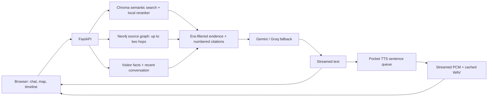

# Jensen Huang Digital Twin

A conversational experience built around Jensen's source material: ask questions, hear replies in the reference voice, and explore the ideas behind each answer through an interactive knowledge graph.

**[Enter the live office](https://rj8307-digital-twin-2.hf.space)** · **[Explore the showcase](https://rj8307-digital-twin-2.hf.space/showcase)** · [Hugging Face Space](https://huggingface.co/spaces/RJ8307/digital-twin-2)

The application combines Chroma semantic search, local reranking, Neo4j graph retrieval, Gemini with Groq fallback, and streamed Pocket TTS. Answers expose numbered source excerpts, while conversation memory records facts about the visitor separately from the public source graph.

[](https://rj8307-digital-twin-2.hf.space)

*Jensen's World is built before you chat. Click a topic to ask about it; select a connection to inspect its supporting passage.*

## Try it

1. Open the [live office](https://rj8307-digital-twin-2.hf.space) and select **Enter Office**. Voice and ambient music have their own controls.
2. Ask “Explain CUDA and why software matters” in **Beginner** mode, or try **Startup pitch** and **Architecture review** for structured feedback.
3. Open **Explore Jensen's Map**, search for CUDA, Blackwell, or digital twins, and follow a topic into the current chat. Gold connections expose extracted relationships and exact quotes.
4. Open **Source timeline & comparisons** to compare accelerated computing in 2019 and 2025. Select a numbered citation in a reply to read the evidence and open its original source.

## Features

| Feature | What you can do |
| --- | --- |
| Streaming chat | Read text as it arrives, see three bouncing dots during generation, and stop an unfinished reply. |
| Reference voice | Hear sentence-by-sentence speech from Pocket TTS using `jensen_ref.wav`; inspect the queue or stop synthesis and buffered audio. |
| Ambient audio | Toggle background music, adjust its volume, and hear it soften during speech. |
| Source-backed answers | Open numbered citations, exact excerpts, and registered original links. Timestamps appear only when supplied by the corpus. |
| Jensen's World | Search and filter the public topic map, click nodes to ask questions, and inspect co-mentions or directed relationships. |
| GraphRAG | Retrieve relevant source passages through bounded Neo4j paths alongside vector search. |
| Timeline and eras | Restrict evidence by era or compare two source years; missing dated coverage is surfaced. |
| Response modes | Choose Conversation, Beginner, Startup pitch, or Architecture review. |
| Conversation memory | View the conversation graph, inspect/edit/forget individual facts, and see which remembered facts were used in a reply. |
| Project showcase | Explore guided demos, the architecture, corpus quality checks, and a published evaluation. |

## How it works



Embeddings run locally through Chroma's ONNX MiniLM embedding function. A `cross-encoder/ms-marco-MiniLM-L6-v2` reranker selects the top five vector-search passages, falling back to embedding ranking if reranking is unavailable. The source graph adds related evidence, and the prompt combines those passages with the selected era, response mode, and relevant visitor memory. Gemini transient failures receive bounded retries before Groq fallback; a stream never switches providers after it has emitted text.

Text and voice run separately so speech initialization does not delay the text answer. The voice model and encoded reference state are reused after successful initialization. CPU synthesis is serialized, and cancelling a reply or voice job stops its unfinished work.

### Two graphs with different jobs

| Graph | Built from | Update behavior |
| --- | --- | --- |
| **Jensen's World** | Source passages already in Chroma | Built at startup; source fingerprint changes rebuild the map and retire obsolete public entries. |
| **Jensen's Memory** | Completed user/assistant turns | Extracts visitor facts and relationships every five completed turns by default, with a manual update/save option. |

The verified source snapshot contains **282 passages from 11 source files**, **102 topics plus seven category nodes**, and **eight extracted semantic relationships**. The topic/co-mention map covers the full corpus; extracted relationships have narrower evidence coverage. Counts change when the corpus changes and can be checked at [`/api/corpus/status`](https://rj8307-digital-twin-2.hf.space/api/corpus/status).

<details>
<summary>Source graph provenance and extraction</summary>

Startup reads existing Chroma passages without re-embedding them. A topic/alias catalog identifies subjects present in the text and builds co-mention connections. Co-mentions indicate shared source passages; they do not establish causation or partnership.

A separate bounded extraction job accepts `INTRODUCED`, `BUILT_ON`, `ENABLES`, `USES`, `DISCUSSED_AT`, and `PARTNERED_WITH`. Each link must use known entity IDs, compatible entity types, and an exact contiguous quote mentioning both entities with explicit relationship wording. Active/passive direction is checked. These checks establish provenance, rather than independent human verification of the interpretation.

`MAP_RELATION_BATCHES=8` samples up to 48 passages, six per batch, across source files. The maximum is 60 batches. Results are cached in Neo4j by corpus fingerprint; the matching bundled [relationship snapshot](evals/source-relations.json) is revalidated against the corpus on startup. For broader extraction, increase the batch limit when introducing a new corpus version; changing the limit alone does not invalidate an existing cache.

Normal chat traverses up to two source-graph hops. If Neo4j is unavailable, the same bounded traversal uses the in-process corpus graph. Path evidence is filtered by era, and two-year comparisons exclude other years. Reply metadata reports graph paths, the retrieval backend, citations, and timing.

Public source nodes use `DTKnowledgeMap`, `DTKnowledgeEntity`, and `DT_KNOWLEDGE_LINK`. Conversation memory uses the separate `MemoryEntity`, `MemoryBatch`, and `MEMORY_LINK` namespace. Public graph refreshes do not delete visitor facts.

</details>

## Run locally

The GitHub repository includes the Chroma index, source files, images, and reference WAV as ordinary Git files. You can run the existing corpus without collecting transcripts or re-ingesting it.

Clone the repository and create your local configuration:

```sh
git clone https://github.com/Ritwik389/digital-twin.git
cd digital-twin
cp .env.example .env.local
```

Fill in `.env.local` using the [configuration table](#configuration), then choose Docker Compose or a Python environment.

### Docker Compose

With Docker and Compose installed, start the application:

```sh
docker compose up --build
```

Open [http://localhost:7860](http://localhost:7860). Compose explicitly builds `Dockerfile` and maps `7860:7860`, matching the image and Hugging Face metadata. The image installs Python 3.12, CPU PyTorch, libsndfile, and ffmpeg. Compose mounts the local `storage/` and `audio_cache/` directories. Initial model downloads require network access; the first retrieval and voice request can take longer while models initialize.

### Python environment

Use Python 3.12 and install libsndfile on your operating system. ffmpeg is needed for the optional audio collection pipeline.

```sh
python3.12 -m venv .venv
source .venv/bin/activate
python -m pip install --upgrade pip
```

On Linux, install CPU PyTorch before the remaining dependencies:

```sh
python -m pip install torch --index-url https://download.pytorch.org/whl/cpu
```

On macOS, use `python -m pip install torch`. Then, from the repository root with `.env.local` configured:

```sh
python -m pip install -r requirements.txt
uvicorn main:app --host 0.0.0.0 --port 7860
```

`main.py` loads `.env.local` automatically. If cloning the **Hugging Face repository** instead, install Git LFS and run `git lfs pull` to retrieve its actual binary assets; that step is not required for this GitHub clone.

## Configuration

For local development, use the ignored `.env.local` file. On Hugging Face, set credentials in **Space Settings → Secrets** and restart after changing them. Never commit credentials.

| Variable | Required for | Value |
| --- | --- | --- |
| `GOOGLE_API_KEY_1` | Gemini chat | Gemini API key. `GOOGLE_API_KEY`, `GEMINI_API_KEY`, and numbered keys 1–3 are also supported. |
| `GROQ_API_KEY` | Groq chat/fallback | Optional fallback when Gemini is configured; a Groq-only deployment also works. Chat needs at least one provider. |
| `HF_TOKEN` | Reference voice | Read token from an account that has accepted access conditions for [`kyutai/pocket-tts`](https://huggingface.co/kyutai/pocket-tts). Fine-grained tokens need gated model access. |
| `NEO4J_URI` | Neo4j source retrieval and conversation graph | Full connection URI, for example `neo4j+s://<instance-id>.databases.neo4j.io`. |
| `NEO4J_USERNAME` | Neo4j connection | Database username from your credentials, commonly `neo4j`. |
| `NEO4J_PASSWORD` | Neo4j connection | Database password. |

Copy the **connection URI** from your Aura instance. The instance ID is part of the hostname; use the supplied database username separately. Leave `NEO4J_DATABASE` blank to use that user's home database. A source map and corpus-graph retrieval are available without Neo4j, but the external conversation graph needs a working connection.

Optional settings and defaults (see [`.env.example`](.env.example) for configuration examples):

- `GEMINI_MODEL=gemini-2.5-flash` and `GROQ_MODEL=openai/gpt-oss-120b` select the configured generation models.
- `MEMORY_UPDATE_TURNS=5` counts completed user/assistant pairs.
- `POCKET_TTS_REFERENCE=jensen_ref.wav` and `POCKET_TTS_LANGUAGE=english` select the reference and language.
- `CHROMA_PATH`, `MEMORY_DB_PATH`, and `AUDIO_DIR` select local storage locations.
- `MAP_RELATION_BATCHES=8` limits new source-relationship extraction.

### Verify the setup

```sh
curl http://localhost:7860/api/health
curl http://localhost:7860/api/corpus/status
```

`chat_configured` and `neo4j_configured` indicate that the required variables are present; they do not prove the credentials are valid. `tts_loaded` becomes true after a successful voice initialization. `voice_status` and `voice_error` distinguish uninitialized, ready, and unavailable voice. Confirm operation by sending a message, playing a reply, and opening the graph.

| Symptom | Check |
| --- | --- |
| Chat fails before text starts | At least one provider key is valid; check provider quota and the server's error message. |
| Voice reports HTTP 401/403 | `HF_TOKEN` is valid and belongs to an account with access to the cloning weights. Update the secret and restart. |
| Voice says the reference is missing | `jensen_ref.wav` is a real WAV file at `POCKET_TTS_REFERENCE`; HF clones must have their LFS content downloaded. |
| No source passages appear | `CHROMA_PATH` points to the included index; a new empty directory has no corpus until ingestion. |
| Neo4j does not synchronize | Check the full URI, database credentials, network availability, and optional database name. |
| Speech waits in the queue | CPU voice jobs run one at a time. Stop Voice cancels your active job and queued sentences. |

### Availability and concurrency

Provider calls, embedding/reranking, graph operations, and TTS run in synchronous FastAPI handlers or dedicated stream workers. Async stream transport awaits queue reads in a thread, and startup offloads model/graph initialization. A blocked generation does not block the event loop or health route. This does not eliminate CPU contention or thread-pool limits.

A provider failure returns HTTP 503 or a `generation_unavailable` stream error without saving an unfinished turn. Missing source evidence produces an explicit coverage abstention; a retrieval outage produces a distinct temporary-error reply without dropping year/domain filters or saving that error as a conversation turn. Reranker failure retains the filtered vector order and reports `vector_fallback`. Voice failure produces a `tts_unavailable` event and leaves the text readable; Play can retry after configuration is repaired.

## Evaluation

The [50-question evaluation set](evals/grounded_questions.json) includes supporting passage IDs and quotes, era restrictions, absent answers, and misleading premises. Both vector retrieval and cross-encoder reranking use the same 15 candidates and return five passages. A balanced 16-question subset produces 32 answers for explicit claim, abstention, and premise-correction review.

The [paired report](reports/evaluation.json) records recall@5, candidate recall@15, MRR@5, nDCG@5, citation support, abstention, failures, and latency. The [protocol and review rubric](evals/README.md) define each metric and its limitations. Initial passage labels and coding-agent claim reviews are **provisional until independently reviewed by a human**. Citation ID validity alone is not evidence of factual support. The showcase reads this report at `/api/evaluation`.

The live run on **October 11, 2026, 06:17 UTC** completed all 100 retrieval requests and all 32 answer samples. The table below uses provisional passage labels and coding-agent claim reviews; it is **not a human-validated accuracy score**.

| Metric | Vector top 5 | Reranked top 5 |
| --- | ---: | ---: |
| Recall@5 (36 positive-labeled questions) | 33.3% | 47.2% |
| Candidate recall@15 | 47.2% | 47.2% |
| MRR@5 | 0.248 | 0.394 |
| nDCG@5 | 0.269 | 0.414 |
| Retrieval client p50 / p95 | 0.65 / 0.74 s | 2.00 / 2.29 s |
| First text client p50 / p95 | 3.98 / 4.67 s | 5.60 / 10.68 s |
| Cited claim support (reviewed claims) | 67.8% · 40/59 | 75.0% · 42/56 |
| Abstention recall (6 cases each) | 100% · 6/6 | 83.3% · 5/6 |
| False abstention (10 answerable cases each) | 0% · 0/10 | 10% · 1/10 |
| Misleading premise correction (4 cases each) | 75% · 3/4 | 75% · 3/4 |

All returned source years passed their era filters, and all numbered references resolved. The manual review still found an answer-level era leak, unsupported side claims, and DGX versus DGX-pod specification confusion. Both pipelines accepted the misleading Blackwell premise; reranking also falsely abstained on an answerable Grace-era question. Those cases remain visible in [the 32 response reviews](evals/manual_reviews.json). Some questions and relevance judgments need refinement, including the potentially ambiguous CUDA-platform question and additional valid H100 passages outside the initial qrels. Candidate retrieval is the limiting stage in this sample: reranking retained every annotated positive present in its pool but could not recover missing candidates.

```sh
python -m pip install pytest httpx
python -m pytest -q tests
node --check static/app.js
node --check static/stream.js
node --check static/explorer.js
node --check static/workbench.js
python evaluate.py --base http://127.0.0.1:7860 --generation
python evaluate.py --score-manual --reviews evals/manual_reviews.json
```

The runner checks the corpus fingerprint, rejects reranker fallback, records warmup separately, and uses disposable conversations with graph and voice disabled. It writes exact answers and source excerpts plus a review template. Provider errors are failures, not correct abstentions. Node.js is only needed for JavaScript syntax checks. The older [alias-based benchmark](reports/benchmark.json) remains a historical check, available at `/api/benchmark`.

## Corpus maintenance

The running map reads the Chroma index, so adding a transcript file alone does not update it. To extend the corpus, add cleaned text in `data/cleaned/` with a metadata header:

```text
SOURCE: keynote
YEAR: 2025
DOMAIN: gpu_computing
---
Transcript text goes here.
```

Register the original title and URL in [`source_catalog.json`](source_catalog.json), then run:

```sh
python ingest.py
```

Run ingestion from the repository root. This standalone script does not load `.env.local`; export `CHROMA_PATH` first if you use a nondefault index path. Restart the application afterward so the source map sees the new fingerprint. Ingestion hashes source content, skips unchanged versions, upserts new chunks, and removes obsolete chunks for that file only after the new write succeeds.

For optional collection/transcription/cleaning tools, install `requirements-ingest.txt` separately and review `data_collector.py` and `cleaner.py` before running them.

Quality checks flag duplicates, undated material, missing original URLs, and possible transcript errors while preserving source wording. The included `jensen_personal.txt` has a 2007 label but contains 2025/2026 events, so it is undated for retrieval and excluded from era-limited answers. The source registry also corrects `milken_2026.txt` to the year of its linked official 2025 transcript while retaining the declared date. The current indexed corpus has six undated passages and six passages without original URLs; see the live [corpus status](https://rj8307-digital-twin-2.hf.space/api/corpus/status) for details.

## Memory and storage

The existing browser visitor IDs and demo access are retained, without an ownership cookie or account authentication. Caller-supplied IDs are labels, not proof of ownership; do not use this demo for private or sensitive conversations. This keeps access behavior unchanged at the project owner's request.

Recent prompt history lives in the server process; completed turns awaiting graph extraction and locally saved facts use `storage/memory.db`. Neo4j stores the external conversation graph. Default Hugging Face Space storage is ephemeral across rebuilds; local Docker Compose mounts the storage directories from your checkout.

Only completed replies become completed turns. Failed memory extraction leaves pending turns available for retry. Fact edits/deletions are scoped to the current visitor. Forgetting a fact suppresses its exact wording in later extraction of old chat; paraphrases are not covered by that check. Deleting a browser chat removes its local display; saved facts are managed separately through the memory controls. There is no account authentication. A stable per-visitor lock serializes turns and reset/save/clear operations, including when agents leave the LRU cache. The locking design assumes one application process, as configured in Docker; multiple workers would require coordinated locks.

## API

FastAPI's interactive schema is available at `/docs` on your running instance.

| Route | Purpose |
| --- | --- |
| `GET /api/health` | Configuration and voice initialization state, without secret values |
| `POST /api/chat` | Complete reply with citations, graph paths, and timing |
| `POST /api/chat/stream` | NDJSON `meta`, `delta`, `done`, or `error` events |
| `POST /api/speak/stream` | `{text,request_id}` → queued status, PCM chunks, and cached WAV |
| `POST /api/speak/cancel` | Cancel the voice job identified by `{request_id}` |
| `POST /api/speak` | Complete WAV generation |
| `GET /api/audio/{filename}` | Generated WAV playback |
| `GET /api/knowledge-map` | Public source map and relationship state |
| `GET /api/knowledge-map/node/{node_id}` | Topic and supporting excerpts |
| `GET /api/timeline` | Dated corpus coverage |
| `GET /api/corpus/status` | Fingerprint and quality checks |
| `POST /api/retrieval/inspect` | Source retrieval diagnostics |
| `GET /api/evaluation` | Paired labeled evaluation JSON |
| `GET /api/benchmark` | Historical alias-based benchmark |
| `GET /api/memory/{user_id}` | Remembered visitor facts |
| `PATCH /api/memory/fact` | Edit `{user_id,old_fact,fact,category,importance}` |
| `DELETE /api/memory/fact` | Forget `{user_id,fact}` |
| `GET /api/graph/{user_id}` | Visitor conversation graph |
| `POST /api/graph/update` | Flush pending visitor memory |
| `POST /api/session/save` | Save memory from `{user_id,session_id}` |
| `POST /api/session/reset` | Reset short-term prompt history |
| `DELETE /api/memory/{user_id}` | Clear that visitor's memory |

Chat accepts `message`, `user_id`, `session_id`, `era`, `mode`, optional `knowledge_node_id`, and optional two-element `compare_years`. Eras are `all`, `pre_cuda` (through 2007), `deep_learning` (2012–2021), and `llm_era` (2022 onward). Modes are `conversation`, `beginner`, `pitch`, `architecture`, and `compare`. Set `use_graph=false` to exclude graph evidence and `retrieval_strategy` to `vector` or `reranked` for comparison. Retrieval inspection accepts `strategy` and `strict_reranker`; use strict mode when evaluating reranking. Voice streaming uses a UUID-format `request_id`. Browser requests cannot execute arbitrary Cypher.

## Repository guide

| Path | Responsibility |
| --- | --- |
| [`main.py`](main.py), [`agent.py`](agent.py) | FastAPI routes and response orchestration |
| [`rag.py`](rag.py), [`chroma_utils.py`](chroma_utils.py) | Semantic retrieval and reranking |
| [`knowledge_map.py`](knowledge_map.py), [`graph_reasoning.py`](graph_reasoning.py) | Public map, relationship validation, and source paths |
| [`knowledge_graph.py`](knowledge_graph.py), [`memory.py`](memory.py) | Conversation graph and local memory |
| [`api_client.py`](api_client.py), [`tts.py`](tts.py), [`streaming.py`](streaming.py) | Generation providers, reference voice, and stream transport |
| [`static/`](static/) | Office interface, map explorer, audio, and showcase |
| [`data/`](https://github.com/Ritwik389/digital-twin/tree/main/data), [`source_catalog.json`](source_catalog.json), [`ingest.py`](ingest.py) | Source texts, provenance, and versioned ingestion |
| [`tests/`](tests/), [`evals/`](evals/), [`reports/evaluation.json`](reports/evaluation.json) | Regression checks and reproducible evaluation |

Reference documentation: [Gemini streaming](https://ai.google.dev/api/generate-content#method:-models.streamgeneratecontent), [Groq text generation](https://console.groq.com/docs/text-chat), [Pocket TTS](https://github.com/kyutai-labs/pocket-tts), and the [Neo4j Python driver](https://neo4j.com/docs/python-manual/current/query-simple/).
